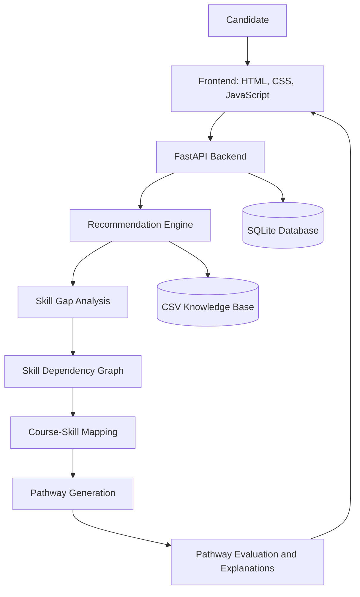

# SkillPath AI – AI-Powered Skill Gap Analysis and Career Pathway Recommendation System

SkillPath AI is an AI-driven career guidance and learning pathway recommendation system that identifies the gap between a candidate's existing skills and the skills demanded by a target occupation.

The system analyses job-market skill demand, identifies missing skills, considers prerequisite relationships and recommends multiple structured learning pathways based on the candidate's available time.

## Project Overview

The objective of SkillPath AI is to help candidates understand:
- Which skills they currently possess.
- Which skills are missing for their target occupation.
- Which missing skills are most relevant to the job market.
- Which courses can help them acquire those skills.
- In what order they should learn those skills.
- Which learning pathway best fits their available time.

The system currently supports **16 selected technical occupations** through a data-driven recommendation engine.

## Key Features

### 1. Skill Gap Analysis
- Compares candidate skills against occupation-specific skill requirements.
- Identifies missing skills.
- Ranks skill gaps according to job-market demand.
- Supports skill-name normalisation and aliases to improve matching.

### 2. Job-Market Skill Demand Analysis
- Uses job-posting and skill-demand data.
- Identifies frequently demanded technical skills.
- Maps skills to relevant occupations.
- Uses processed and normalised skill-demand datasets.

### 3. Multiple Learning Pathways

The system generates up to three learning pathways:

| Pathway | Objective |
|---|---|
| FASTEST | Prioritises a shorter learning route. |
| BALANCED | Balances learning time and skill coverage. |
| COMPREHENSIVE | Aims for broader skill and demand coverage. |

Pathways are generated using course-skill mappings, skill dependencies, available time and course metadata.

### 4. Prerequisite-Aware Recommendations
- Uses a skill dependency graph.
- Identifies strict and recommended prerequisites.
- Checks prerequisite validity when ordering courses.
- Considers skills acquired through earlier courses in a pathway.

### 5. Course Recommendations
- Maps courses to the skills they explicitly teach.
- Considers course duration, provider, rating and occupation relevance.
- Filters recommendations according to the candidate's time budget.

### 6. Interactive User Interface
- Candidate skill input.
- Target occupation selection.
- Time-budget input.
- Skill-gap visualisation.
- Pathway comparison.
- Course recommendations.
- Skill dependency graph.

### 7. User Feedback and Analysis History
- Stores previous analyses.
- Allows users to provide relevance and explanation-clarity ratings.
- Uses SQLite for analysis history and feedback storage.

## Supported Occupations

The current system supports:

1. Data Analyst
2. Data Scientist
3. Software Developer
4. Full Stack Developer
5. QA / Software Test Engineer
6. Network Engineer
7. Data Engineer
8. Cybersecurity Analyst
9. Database Administrator
10. Machine Learning Engineer
11. DevOps Engineer
12. Cloud Engineer
13. Frontend Developer
14. Backend Developer
15. Mobile App Developer
16. AI Engineer

## System Architecture

The project uses a modular architecture consisting of a frontend, backend recommendation engine, knowledge-base datasets and a database.

### Architecture Flow



### Technology Stack

| Component | Technology |
|---|---|
| Frontend | HTML, CSS, JavaScript |
| Backend | Python, FastAPI |
| API | REST API |
| Data Processing | Python, Pandas |
| Skill Normalisation | Rule-based normalisation and Sentence Transformers |
| Semantic Model | sentence-transformers/all-MiniLM-L6-v2 |
| Recommendation Engine | Python |
| Dependency Management | Skill dependency graph |
| Database | SQLite |
| Data Storage | CSV and JSON |
| Version Control | Git and GitHub |
| Deployment | Render |

## Project Structure

```text
skill-gap-analysis/
│
├── backend/
│   ├── 01_filter_jobs.py
│   ├── 02_extract_summaries.py
│   ├── 03_check_jobs.py
│   ├── 04_prepare_esco.py
│   ├── 05_inspect_job_skills.py
│   ├── 06_build_job_skills.py
│   ├── 07_calculate_skill_demand.py
│   ├── 08_inspect_unique_skills.py
│   ├── 09_clean_job_skills.py
│   ├── 10_exact_normalization.py
│   ├── 11_skill_frequency.py
│   ├── 12_categorize_and_normalize_skills.py
│   ├── 13_semantic_normalization.py
│   ├── 14_5_occupation_relevance.py
│   ├── 14_6_generate_all_occupation_relevance.py
│   ├── 14_check_normalization.py
│   ├── 15_skill_gap.py
│   ├── 16_build_prerequisite_graph.py
│   ├── 17_course_skill_mapping.py
│   ├── 18_generate_pathways.py
│   ├── 19_evaluate_pathways.py
│   ├── 20_generate_explanations.py
│   ├── main.py
│   ├── recommendation_engine.py
│   ├── database.py
│   ├── skill_normalizer.py
│   ├── evaluate_system.py
│   ├── evaluate_extraction.py
│   ├── evaluate_mapping.py
│   └── test_16_occupations.py
│
├── data/
│   ├── raw/
│   │   └── courses.csv
│   ├── processed/
│   │   ├── skill_demand_normalized.csv
│   │   └── occupation_skill_relevance.csv
│   ├── evaluation/
│   ├── candidate_profile.json
│   └── skill_dependencies.csv
│
├── frontend/
│   ├── index.html
│   ├── style.css
│   ├── app.js
│   └── demo-data.js
│
├── reports/
│   ├── occupation_test_matrix.csv
│   ├── pathway_evaluation.csv
│   └── evaluation_summary.md
│
├── requirements.txt
├── start.bat
├── .gitignore
└── README.md
```

The original large job-posting datasets are kept separately and are not included in the GitHub repository. The processed datasets required by the application are included.

## Installation and Local Setup

### Prerequisites

- Python 3.10 or later.
- pip.
- Git.
- Visual Studio Code (recommended).

### Step 1: Clone the Repository

```bash
git clone https://github.com/kripamehta/skill-gap-analysis.git
cd skill-gap-analysis
```

### Step 2: Create a Virtual Environment

Windows PowerShell:

```powershell
python -m venv .venv
.venv\Scripts\Activate.ps1
```

### Step 3: Install Dependencies

```bash
python -m pip install -r requirements.txt
```

### Step 4: Run the Backend

```bash
python -m uvicorn backend.main:app --reload
```

### Step 5: Open the Application

Open:

http://127.0.0.1:8000

The API documentation is available at:

http://127.0.0.1:8000/docs

## API Endpoints

The FastAPI backend provides the following endpoints:

| Method | Endpoint | Description |
|---|---|---|
| GET | `/` | Serves the frontend application |
| GET | `/health` | Checks backend health and engine version |
| GET | `/skills` | Returns known skills |
| GET | `/recommendations` | Returns available recommendations |
| POST | `/recommend` | Generates skill gaps and learning pathways |
| GET | `/history` | Retrieves previous analyses |
| GET | `/history/{id}` | Retrieves a particular analysis |
| POST | `/feedback` | Stores user feedback |
| GET | `/feedback/summary` | Returns aggregated feedback |

### Example Recommendation Request

```json
{
  "target_occupation": "Data Analyst",
  "current_skills": ["Python", "Git", "Excel"],
  "time_budget_hours": 40
}
```

The response includes candidate information, identified skill gaps, course recommendations, learning pathways, pathway evaluations and explanations.

## Data Sources and Processing

The project uses job-market information, skill taxonomies, occupation relevance information and a curated course catalogue.

### Data Processing Pipeline

The backend processing scripts are organised into stages:

1. Job-posting filtering and preparation.
2. Job-summary extraction.
3. Skill extraction and frequency analysis.
4. Skill cleaning and categorisation.
5. Skill normalisation using exact, alias and semantic matching.
6. Occupation-specific skill relevance analysis.
7. Skill-gap identification.
8. Skill prerequisite graph construction.
9. Course-to-skill mapping.
10. Learning pathway generation.
11. Pathway evaluation and explanation generation.

### Dataset References

- LinkedIn Jobs and Skills 2024 dataset: https://www.kaggle.com/datasets/asaniczka/1-3m-linkedin-jobs-and-skills-2024
- ESCO Skills and Occupations: https://esco.ec.europa.eu/
- O*NET Database: https://www.onetcenter.org/database.html

The project also uses a curated course catalogue containing course titles, providers, explicitly mapped skills, duration, ratings and relevant occupations.

Raw datasets are not included in this repository because of their size. The processed knowledge-base files required to run the application are included.

## Evaluation

The recommendation system was evaluated across multiple occupations, candidate profiles and time budgets.

### Evaluation Configuration

| Parameter | Value |
|---|---:|
| Supported occupations tested | 16 |
| Candidate profiles | 2 |
| Time budgets | 4 |
| Time budgets used | 20, 40, 80, 160 hours |
| Total test scenarios | 128 |
| Total pathways evaluated | 378 |

### Pathway Evaluation Results

| Metric | FASTEST | BALANCED | COMPREHENSIVE |
|---|---:|---:|---:|
| Average skill coverage | 17.1% | 42.7% | 44.9% |
| Average demand coverage | 27.4% | 51.5% | 55.3% |
| Prerequisite validity | 100% | 100% | 100% |
| Within-budget feasibility | 100% | 100% | 100% |

### Comparison Against a Single-Course Baseline

| Approach | Average demand coverage | Prerequisites satisfied |
|---|---:|---:|
| Best single-course baseline | 35.9% | 53% |
| COMPREHENSIVE pathway | 55.3% | 100% |

The comprehensive pathway achieved a 19.4 percentage-point improvement in average demand coverage over the single-course baseline in the evaluated scenarios.

### Pathway Diversity

In 91% of the evaluated scenarios, all three pathway types returned different course combinations.

### Evaluation Metrics

The system evaluates:

- Skill coverage: proportion of identified missing skills covered by a pathway.
- Demand coverage: proportion of total missing-skill demand covered.
- Prerequisite validity: whether strict prerequisites are satisfied in the learning sequence.
- Time feasibility: whether the total pathway duration fits the candidate's time budget.
- Course ratings: average available course ratings.
- Pathway diversity: whether the recommended pathway combinations differ.

The pathway quality score is a weighted heuristic used to compare recommendations. It is not a machine-learning accuracy score.

### Running Evaluation Scripts

Run the following commands from the project root:

```bash
python -m backend.test_16_occupations
```

```bash
python -m backend.evaluate_system
```

The system evaluation generates:

- `reports/pathway_evaluation.csv`
- `reports/evaluation_summary.md`

The occupation test generates:

- `reports/occupation_test_matrix.csv`

Additional evaluation scripts are available for skill extraction and semantic mapping. These require manually labelled ground-truth or mapping examples.

## Limitations

- The system currently supports 16 selected technical occupations rather than arbitrary occupations.
- Recommendation quality depends on the coverage and accuracy of the available course catalogue.
- Some occupations have lower skill coverage because suitable mapped courses are limited.
- Pathways are limited to a maximum of four courses in the current implementation.
- Skill-demand data represents the datasets used during development and is not a live job-market feed.
- Semantic skill matching and normalisation may require further human validation.
- SQLite persistence on temporary cloud storage may not survive service restarts or redeployments without persistent storage.

## Future Enhancements

- Expand the occupation and course catalogue.
- Improve semantic skill normalisation and human-validated mapping.
- Add more detailed prerequisite relationships.
- Integrate regularly updated job-market data.
- Improve pathway diversity and time optimisation.
- Introduce persistent cloud database storage.
- Incorporate user feedback into recommendation improvements.
- Improve evaluation using larger manually labelled datasets.

## Deployment

The application can be deployed as a single FastAPI web service on Render because the backend also serves the frontend.

**Build command:**

```bash
pip install -r requirements.txt
```

**Start command:**

```bash
uvicorn backend.main:app --host 0.0.0.0 --port $PORT
```

The live application URL and API documentation link will be added after deployment.

## Project Information

**Project Title:** SkillPath AI – AI-Powered Skill Gap Analysis and Career Pathway Recommendation System

**Branch:** Computer Science and Engineering

**Institution:** Ramaiah University of Applied Sciences

**Developer:** Kripa Mehta

**GitHub Repository:** https://github.com/kripamehta/skill-gap-analysis

---

*SkillPath AI aims to bridge the gap between existing candidate skills and job-market requirements through explainable, prerequisite-aware and personalised learning pathways.*